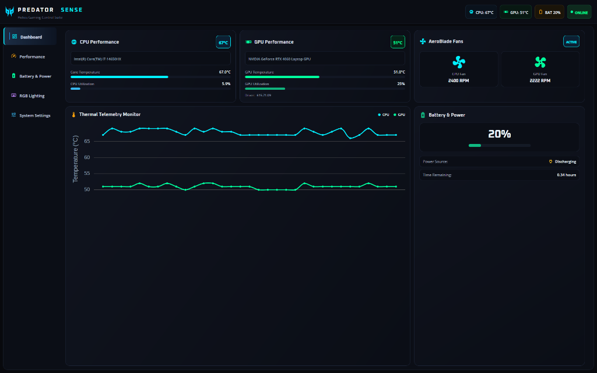
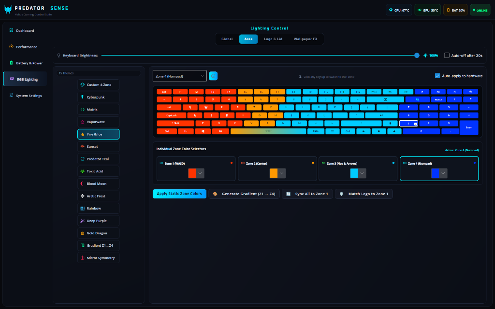
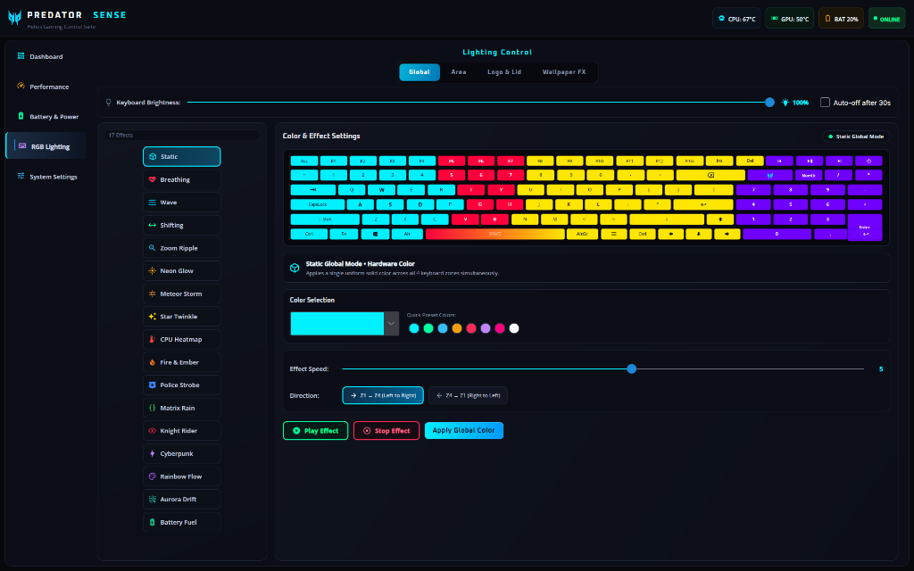
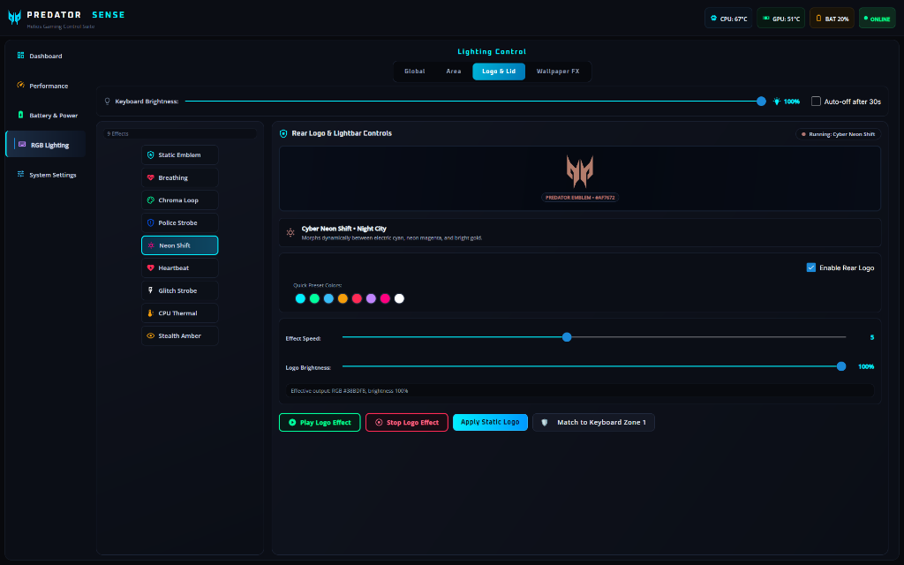
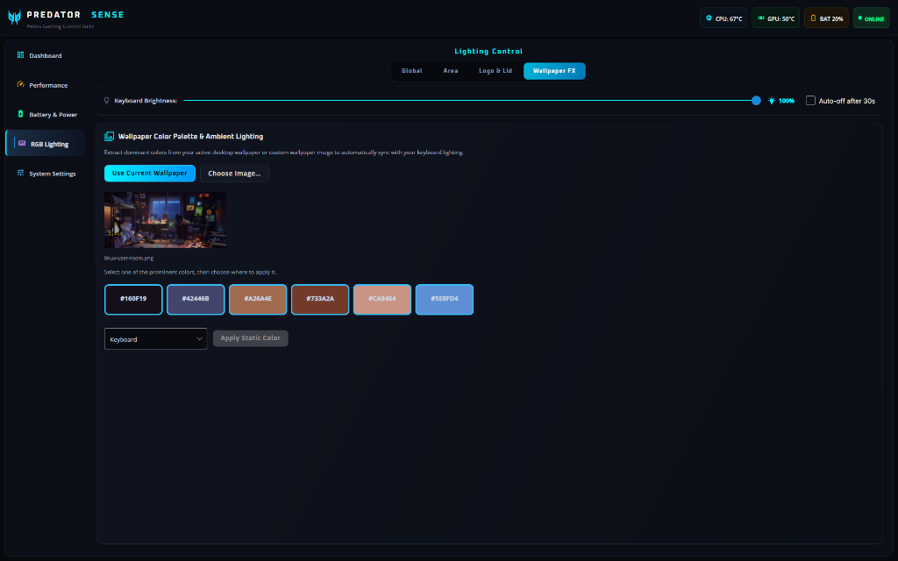

# PredatorSense for Linux 🎮

<div align="center">

[](LICENSE)
[](https://github.com/0PeterAdel/PredatorSense/actions)
[](CONTRIBUTING.md)
[](https://github.com/0PeterAdel/PredatorSense/issues)
[](#-supported-hardware)
[](https://avaloniaui.net/)
[](#-architecture)

**An official-grade, high-performance Linux gaming control center for Acer Predator Helios, Predator Triton, and Acer Nitro laptops.**  
*Engineered with authentic cyber-dark glass styling, 40 FPS real-time hardware telemetry, advanced 4-zone procedural RGB lighting, performance tuning, and native hardware key integration.*

[Features](#-features) • [Screenshots](#-screenshots) • [Supported Hardware](#-supported-hardware) • [Installation](#-installation-one-click) • [Contributing](#-contributing--community) • [License](#-license--mandatory-attribution)

</div>

---

## 📸 Screenshots

<div align="center">

### 📊 Real-Time Cyber Dashboard & Hardware Telemetry


<br/><br/>

### 🌈 4-Zone RGB Lighting Studio & Chiclet Keyboard Visualizer


<br/><br/>

### 🌐 Global Dynamic Lighting Engine & Procedural Effects


<br/><br/>

### 🛡️ Rear Lid Predator Emblem Illumination & Dynamic Modes


<br/><br/>

### 🎨 Wallpaper Color Palette Extraction & Ambient Lighting


</div>

---

## 🌟 Features

### 📊 High-Tech Dashboard & Real-Time Telemetry
- **CPU & GPU Telemetry:** Live hardware temperature gauges, model badges, usage percentages, and dual progress bars.
- **Dual Fan Tachometers:** Symmetrical animated capsules for CPU Fan (Predator Cyan) and GPU Fan (Neon Green) displaying real-time live RPM telemetry.
- **Thermal Monitor:** Continuous real-time dual-series telemetry graph powered by LiveCharts.
- **Battery Health & Power:** Battery percentage meter, charging state (AC Connected / Discharging), and power-draw indicators.

### 🌈 16 Dynamic RGB Lighting Animations & 4-Zone Studio
- **7 Hardware Firmware Modes (0% CPU Overhead):**
  - `Spectrum Wave` (Continuous smooth multi-zone color sweep)
  - `Cycling Neon` (Seamless whole-keyboard color loop)
  - `Color Respiration` (Soft pulsing breath aura)
  - `Gradient Shift` (Fluid 4-zone color transition)
  - `Concentric Zoom` (Outward and inward expanding rings)
  - `Sweeping Comets` (High-speed meteor trail streams)
  - `Starlight Shimmer` (Twinkling matrix sparks)
- **9 Smart Software Reactive & Ambient Animations:**
  - `Live Thermal Heatmap` (RGB aura reacts dynamically to real-time CPU & GPU temps)
  - `Organic Hearth Glow` (Calming fire and embers simulation)
  - `Digital Code Rain` (Matrix neon cascade flowing across zones)
  - `High-Intensity Strobe` (Rapid emergency warning flashes)
  - `Bi-Directional Radar Beam` (Knight Rider / Cylon ping-pong scanner)
  - `Dual Neon Pulse` (Alternating cyberpunk cyan and magenta rhythm)
  - `360° Hue Rotation` (Continuous circular spectrum drift)
  - `Polar Ambient Drift` (Soft, soothing aurora glow)
  - `Charge Level Meter` (Keyboard zones light up proportional to laptop battery level)
- **4-Zone Customization & Curated Presets:**
  - Authentic 4-zone Acer Predator chiclet keyboard visualizer with per-key illumination and tactile feedback.
  - One-click presets: *Cyberpunk 2077*, *Matrix Hacker*, *Vaporwave*, *Sunset Horizon*, *Toxic Acid*, *Blood Moon*, *Arctic Frost*, and *Predator Teal*.
  - Built-in two-color linear gradient generator and wallpaper color extractor.
  - Dedicated Rear Lid Logo / Lightbar illumination with custom colors and procedural animations.

### 🚀 Thermal & Performance Profiles
- **5 Predator Tuning Profiles:**
  - **Eco:** Energy-saving mode for maximum battery life.
  - **Quiet:** Low fan noise and silent acoustics for office and library use.
  - **Balanced:** Optimal balance of fan speed and gaming performance.
  - **Performance:** High clock speeds and boosted cooling for demanding workloads.
  - **Turbo:** Peak hardware overclocking with maximum fan RPM.

### 🌀 Fan Speed Control
- **Auto:** Dynamic RPM managed by EC hardware firmware.
- **Max:** 100% full-throttle fan speeds for intensive gaming sessions.
- **Custom Sliders:** Independent sliders for CPU and GPU fans with thermal throttling indicators.

### 🔋 Battery Health & Power Management
- **80% Battery Charge Limit:** Protects battery cycle health for laptops plugged into AC power.
- **Battery Calibration:** Automated full-cycle calibration for the battery fuel gauge.
- **USB Power-Off Delivery:** Charge mobile phones and external devices while the laptop is powered off or in sleep mode (configurable thresholds: 10%, 20%, 30%).

### ⚡ System Settings & Hardware Matrix
- **LCD Overdrive:** Lowers display response time to eliminate ghosting and motion blur in fast-paced esports.
- **Boot Sound & Logo Animation:** Enable or mute the signature Predator boot chime and display animation.
- **System Specifications:** Instant display of Laptop Model, EC Driver Version, Daemon Version, and Active Kernel.

### ⌨️ Hardware Predator Key Binding
- The dedicated physical **Predator key** (`XF86Launch7`) automatically toggles the application window.
- Out-of-the-box support for **Hyprland**, **GNOME**, **KDE Plasma**, **Sway**, and **i3**.

---

## 💻 Supported Hardware

Tested and verified on modern Acer gaming laptops:
- **Acer Predator Helios 16** (PH16-71, PH16-72)
- **Acer Predator Helios 18** (PH18-71, PH18-72)
- **Acer Predator Helios Neo 16** (PHN16-71, PHN16-72)
- **Acer Predator Triton 14 / 16 / 17** (PT14-51, PT16-51, PTX17-71)
- **Acer Nitro 5 / 16 / 17** (AN515-58, AN16-41, AN16-51, AN17-41, AN17-51, AN17-71)

*Have another Acer gaming laptop? Test it and submit a [Hardware Compatibility Report](https://github.com/0PeterAdel/PredatorSense/issues/new?template=hardware_compatibility.md)!*

---

## 📥 Installation (One-Click)

### 1. Clone the repository:
```bash
git clone https://github.com/0PeterAdel/PredatorSense.git
cd PredatorSense
```

### 2. Run the automated installer with root privileges:
```bash
sudo ./install.sh
```

The installer takes care of everything automatically:
1. Verifies build dependencies (`dotnet-sdk-9.0`, `python3`, `gcc`, `make`, `linux-headers`).
2. Compiles and installs the `linuwu_sense` kernel driver (replacing `acer_wmi`).
3. Sets up and activates the `predatorsense-daemon` background systemd service.
4. Builds the .NET 9 Avalonia GUI and installs system binaries.
5. Configures desktop launcher shortcuts and maps the physical **Predator key** (`XF86Launch7`).

---

## 🛠️ Usage

- **Application Menu:** Launch **Predator Sense** from your application menu or launcher (Rofi, Wofi, GNOME, KDE).
- **Terminal:** Run `predatorsense` anywhere in your terminal.
- **Hardware Key:** Press the dedicated **Predator button** on your laptop keyboard to toggle the window.
- **Toggle Script:** Run `predatorsense-toggle` to open or minimize the window.

### Daemon Service Management
```bash
# Check daemon status
systemctl status predatorsense-daemon.service

# Restart daemon
sudo systemctl restart predatorsense-daemon.service

# View daemon logs
journalctl -u predatorsense-daemon.service -f
```

---

## 🏗️ Architecture

```
PredatorSense/
├── driver/                 # linuwu_sense kernel module (replaces acer_wmi)
│   ├── src/linuwu_sense.c  # WMI & ACPI gaming interface driver
│   ├── dkms.conf           # DKMS configuration for automated kernel updates
│   └── Makefile            # Driver compilation targets
├── daemon/                 # Python backend daemon service
│   ├── predatorsense_daemon.py # UNIX socket server & hardware controller
│   ├── KeyboardMonitor.py      # Hardware key event listener
│   └── PowerSourceDetection.py # AC/Battery power state detector
├── gui/                    # Modern Avalonia UI .NET 9 desktop application
│   ├── MainWindow.axaml    # RGB Lighting, Performance, Battery, Settings tabs
│   ├── Dashboard.axaml     # Hardware telemetry & tachometer gauges
│   ├── DynamicEffectsEngine.cs # 16 procedural RGB lighting effects
│   └── PredatorSenseClient.cs  # High-speed UNIX socket client
├── packaging/              # Desktop integration files
│   ├── predatorsense.desktop   # XDG desktop shortcut
│   ├── predatorsense.png       # High-resolution 256x256 app icon
│   ├── predatorsense.tmpfiles  # Sysfs permission manager
│   ├── 99-predatorsense.rules  # Udev device access rules
│   └── predatorsense-toggle.sh # Hardware key window toggle script
├── install.sh              # Master one-click installer
└── uninstall.sh            # Complete uninstaller
```

---

## 🤝 Contributing & Community

Contributions are what make the open-source community such an amazing place to learn, inspire, and create. Any contributions you make are **greatly appreciated**!

- **Pull Requests:** Feel free to fork the repository, make your changes, and submit a PR! Please read our [Contributing Guidelines](CONTRIBUTING.md) and fill out the PR template.
- **Bug Reports & Features:** Found an issue or have an idea? Open an issue on our [Issue Tracker](https://github.com/0PeterAdel/PredatorSense/issues).
- **Code of Conduct:** Please review our [Code of Conduct](CODE_OF_CONDUCT.md) before participating.

---

## 🗑️ Uninstallation

To cleanly remove PredatorSense, restore default kernel modules (`acer_wmi`), and clean up all system files:
```bash
sudo ./uninstall.sh
```

---

## 📄 License & Mandatory Attribution

This project is licensed under the **GNU General Public License v3.0 (GPLv3)** with an **Author Attribution Requirement** under Section 7(b).

### Summary of Terms:
- **Commercial & Non-Commercial Use:** You are free to use, run, modify, fork, and distribute this software.
- **Mandatory Author Attribution:** Any public redistribution, fork, modification, or inclusion of this codebase in another project **must clearly and prominently retain copyright notices and explicitly attribute the original author (Peter Adel / 0PeterAdel) with a link back to this official repository:**
  > **https://github.com/0PeterAdel/PredatorSense**

See the full [LICENSE](LICENSE) file for legal details.

---

## 👤 Author & Acknowledgments

- **Lead Author & Maintainer:** Peter Adel ([@0PeterAdel](https://github.com/0PeterAdel))
- Built with ❤️ for the Linux Gaming Community.
